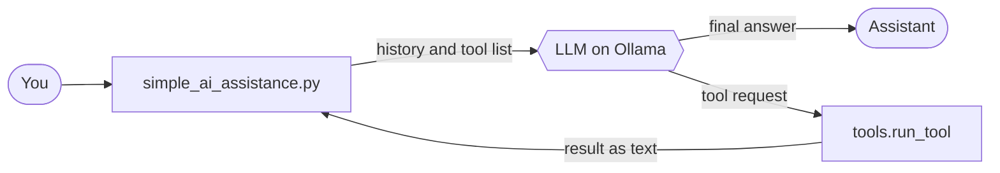

A local AI agent built from scratch in Python. It talks to a model running on Ollama through the OpenAI-compatible API, so there is no paid key and no framework hiding the logic.

🌱 Work in progress: This project is in its early phase

## ✨ Features

| | Feature | Details |
|---|---|---|
| 🧠 | **Conversation memory** | The full history is sent on every call, because the model itself has no memory |
| 🎭 | **System prompt** | Sets the agent's behavior and style |
| 🔧 | **Tool calling** | Tools are described with JSON schema and run by our own code |
| 🔗 | **Chained tool calls** | A loop with a step limit (`MAX_STEPS = 5`) so it can never run forever |
| 📝 | **Required parameters** | `get_city_weather` needs a city, declared in the schema |
| 🛡️ | **Safe errors** | Tool failures go back to the model as text, so the program does not crash |
| 🪲 | **Debug trace** | Grey step-by-step logs, switched on with `DEBUG=True` |
| ⚡ | **Streaming responses** | The reply is printed token by token as the model generates it, so you do not wait for the full answer |
| ⏹️ | **Stop with Ctrl+C** | Press `Ctrl+C` while the assistant is answering to stop the stream. The partial reply is kept in the history and you can ask the next question |
| 🧵 | **Streamed tool calls** | Tool requests arrive in small chunks while streaming. The code stitches them together, including several tool calls in one step |
| 🚧 | **Step-limit fallback** | If the model has not given a final answer after `MAX_STEPS`, you get a clear "could not finish" message instead of a hang |

## 🧩 How it works

The model **never runs code**. It only asks for a tool. Our Python code runs it, sends the result back, and the loop repeats until the model answers in plain text.

🧩 How it works
The model never runs code. It only asks for a tool. Our Python code runs it, sends the result back, and the loop repeats until the model answers in plain text.

📖 The 4-step loop in words (click to expand)
⚡ Streaming: each call to the model is made with stream=True. Text is printed as soon as it arrives, while any tool request is collected piece by piece and run only after the stream ends.

## 🛠️ Available tools

| Tool | What it does |
|---|---|
| `get_current_time` | Returns the current local date and time |
| `get_city_weather(city)` | One-line weather from the free `wttr.in` service |
| `get_user_city` | Returns the user's city (hard-coded to `Bangalore` as a demo value) |

